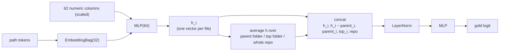

# Deep learn file scorer

This is a small PyTorch model that gives every file in a repo a score. A high
score means the file is a good fit for a cheatsheet. It takes the place of the
old XGBoost `FileScorer` in `collector.py` (`SCORER_MODEL = "nn_scorer.pt"`).

## How to use it

Install:

```bash
uv pip install torch scikit-learn pyyaml
```

Score a repo. You only need the checkout and the list of all its files:

```py
from model.nn.scorer import NNScorer

scorer = NNScorer.load("nn_scorer.pt")
scores = scorer.score_repo(repo_root, all_files, repo_name)   # {path: score}
```

Pass in *all* the files, not just the ones you care about. The model looks at
each file next to its neighbors, so it needs the full list. A repo with 3–5k
files takes about 4–12 seconds. A fresh clone on Windows is slower.

To train or test, you need the repos in `source/` and the gold lists in
`model/tmp/gold/` (see `model/README.md`):

```bash
# which single columns pick out gold files?
python -m model.nn.train signals

# leave one repo out, compare with old methods, run ablations
python -m model.nn.train loro --xgb --pkl llm_scorer_v8.pkl --ablate

# what would collector.py really pick?
python -m model.nn.train e2e --pkl llm_scorer_v8.pkl

# final test on repos the model never tuned on. Run once per round of changes.
python -m model.nn.train holdout --xgb --pkl llm_scorer_v8.pkl

# train the real model on all gold repos
python -m model.nn.train fit --out nn_scorer.pt
```

Add `--set key=value` to change any field in `scorer.Config`, like epochs or dropout.

Good to know:

- If you change the features, bump `FEATURE_VERSION` in `repo_features.py`. Old caches and old models get rejected until you do.
- To add a gold repo: put it in `source/`, add `model/tmp/gold/<repo>.yaml`, then rerun `loro`, `e2e` and `fit`.
- With only 5 test repos, a gap smaller than 0.01 in mean gold AP is just noise.

## How it compares with the old methods

Every repo is scored by a model that never saw that repo's labels.

What the numbers mean:

- **gold / core**: AP (average precision, how high the right files rank). "gold" counts core + useful files. "core" counts only the core files.
- **p@20**: how many of the top 20 are gold.
- **r@20**: how many core files show up in the top 20.
- **recall / hit**: how many core files we picked, and how many of our picks were core or useful.

The old methods:

- `rule_score`: hand-written rules, no model.
- `llm_scorer_v8.pkl`: the XGBoost model we ship today. It trained on llama.cpp and milvus, so those two columns are not a fair test.
- XGBoost on LLM labels: the same idea, trained on qwen3.5-2b labels.

### Leave one repo out (5 tuning repos)

| | curl | go-redis | llama.cpp | milvus | vite | **mean gold** | **mean core** | p@20 | r@20 |
|---|---|---|---|---|---|---|---|---|---|
| `rule_score` | 0.146 | 0.229 | 0.327 | 0.246 | 0.453 | 0.280 | 0.071 | 0.24 | 0.07 |
| `llm_scorer_v8.pkl` | 0.109 | 0.215 | 0.310 | 0.370 | 0.410 | 0.283 | 0.063 | 0.26 | 0.07 |
| XGBoost on LLM labels | 0.099 | 0.223 | 0.248 | 0.189 | 0.467 | 0.245 | 0.063 | 0.21 | 0.03 |
| **RepoContextNet** | 0.226 | 0.248 | 0.678 | 0.606 | 0.787 | **0.509** | **0.325** | 0.64 | 0.54 |

### What `collector.py` really picks (recall / hit)

| | curl | go-redis | llama.cpp | milvus | vite | **mean recall** | **mean hit** |
|---|---|---|---|---|---|---|---|
| `rule_score` | 0.38 / 0.22 | 0.67 / 0.26 | 0.56 / 0.58 | 0.30 / 0.30 | 0.14 / 0.30 | 0.41 | 0.33 |
| `llm_scorer_v8.pkl` | 0.25 / 0.27 | 0.67 / 0.40 | 0.44 / 0.54 | 0.30 / 0.43 | 0.14 / 0.55 | 0.36 | 0.44 |
| **RepoContextNet** | 0.62 / 0.48 | 0.67 / 0.26 | 0.44 / 0.88 | 0.50 / 0.74 | 0.86 / 0.74 | **0.62** | **0.62** |

With this model, `FileSelector.secondary` just takes the top 20 in order. The
old picking rules (reserved slots for API and example code, caps per folder)
made the same model worse: 0.45 recall and 0.40 hit. So we skip them.

### Holdout test: httpx and ollama

We ran this once. The model trained on the 5 tuning repos only.

| | httpx gold / core | ollama gold / core | **mean gold** | **mean core** | p@20 | r@20 |
|---|---|---|---|---|---|---|
| `rule_score` | 0.774 / 0.395 | 0.584 / 0.257 | 0.679 | 0.326 | 0.80 | 0.70 |
| `llm_scorer_v8.pkl` | 0.752 / 0.165 | 0.603 / 0.161 | 0.677 | 0.163 | 0.80 | 0.60 |
| XGBoost on LLM labels | 0.784 / 0.298 | 0.389 / 0.212 | 0.586 | 0.255 | 0.73 | 0.60 |
| **RepoContextNet** | 0.856 / 0.228 | 0.629 / 0.409 | **0.743** | 0.318 | 0.82 | 0.60 |

| collector picks | httpx recall / hit | ollama recall / hit | **mean recall** | **mean hit** |
|---|---|---|---|---|
| `rule_score` | 0.67 / 0.58 | 0.50 / 0.38 | 0.58 | 0.48 |
| `llm_scorer_v8.pkl` | 0.50 / 0.75 | 0.67 / 0.43 | 0.58 | 0.59 |
| **RepoContextNet** | 0.50 / 0.87 | 0.83 / 0.67 | **0.67** | **0.77** |

The win here is smaller than before. That makes sense, since we designed the
features while looking at the tuning repos. httpx is the weak spot: its API
sits in private modules that `__init__.py` re-exports, and none of the tuning
repos look like that. The real model trains on all 7 repos.

## Why it works better

The old models look at one path at a time. But the gold files are just a few
picks out of many similar files. For example, curl has 298 pages in
`docs/cmdline-opts/`, and only 17 are gold. The path can't tell you which
ones. These things can:

- **Mentions**: the rest of the repo keeps talking about the good files.
- **Links**: the root README or docs index links to the user docs.
- **Content**: code blocks, shell commands, headings, exported symbols, a `main`.
- **Neighbors**: how a file compares with the other files in its folder.

Ablation (mean gold AP, full model = 0.509). We remove one thing at a time:

| Removed | Gold AP |
|---|---|
| mention columns | 0.429 |
| folder pooling | 0.460 |
| structure columns | 0.465 |
| ranking loss | 0.497 |
| path tokens | 0.505 |
| content columns | 0.512 |

Training on LLM labels only gives 0.092. That is why we train on the gold lists.

## The model



- One repo is one batch, because the model needs every file in the repo at once.
- Loss: BCE on the gold labels (gold files count ×5, core files ×2 more), plus a ranking loss over the repo's files.
- 50 epochs, AdamW, one-cycle LR 3e-3, dropout 0.2, token dropout 0.1. The final score is the average of 5 seeds.
- More epochs overfit: gold AP drops to 0.45 at 100 epochs and 0.42 at 200+.

Files:

- `repo_features.py`: builds the features for each repo (`NUMERIC_COLUMNS` lists them)
- `net.py`: the network, `RepoContextNet`
- `scorer.py`: `NNScorer` (vocab, scaling, ensemble, save and load) and `Config`
- `data.py`: joins gold and LLM labels with cached features (`model/tmp/nn_cache/`)
- `train.py`: the commands `signals`, `loro`, `e2e`, `holdout`, `fit`
